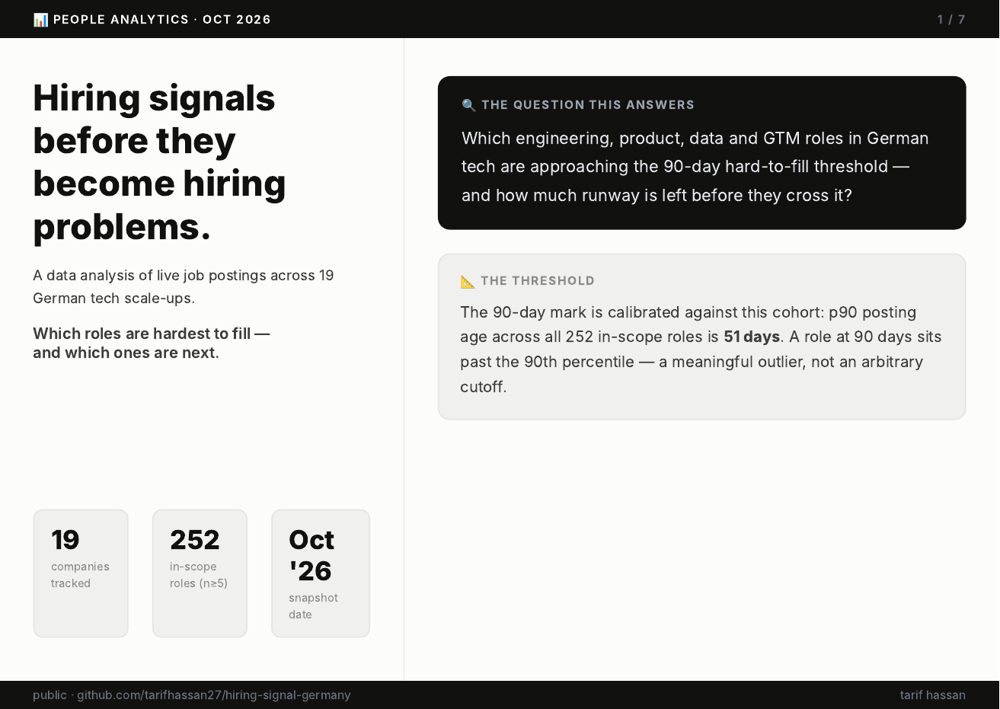
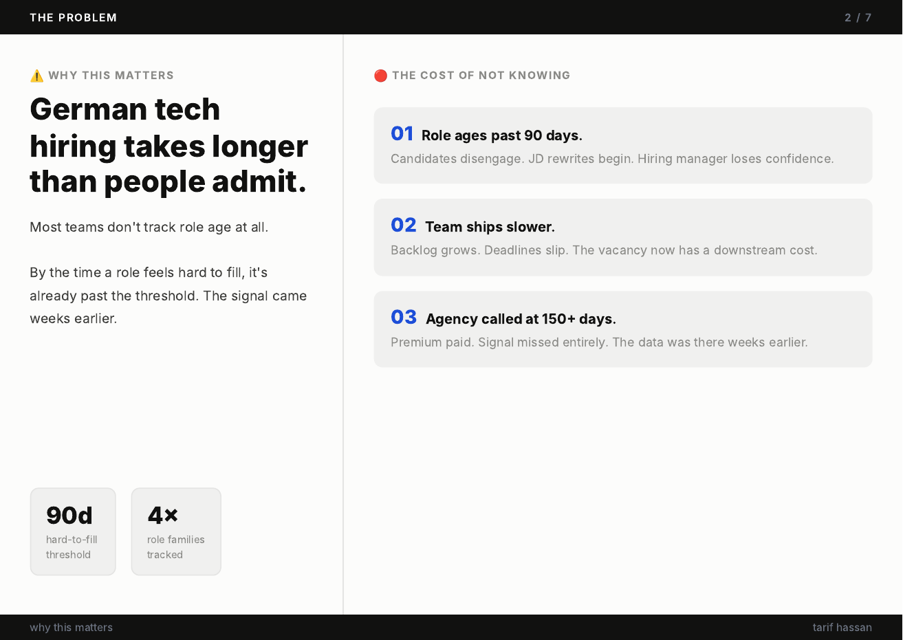
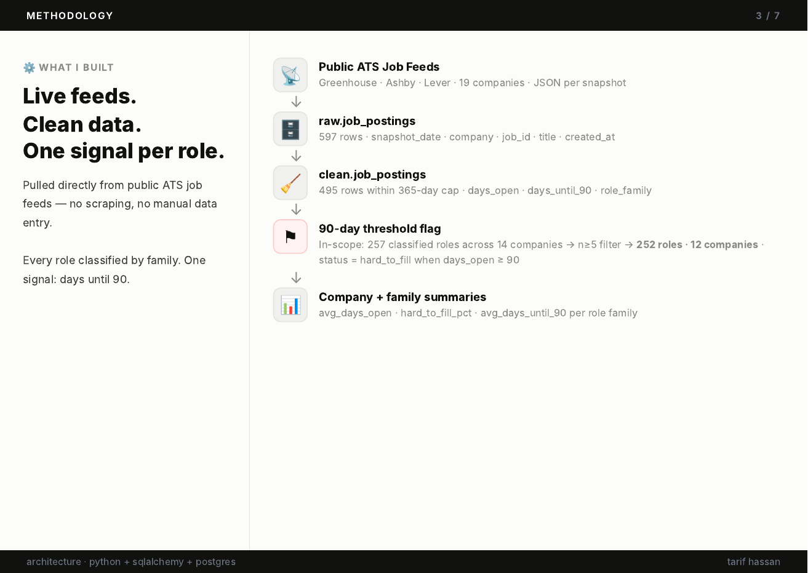
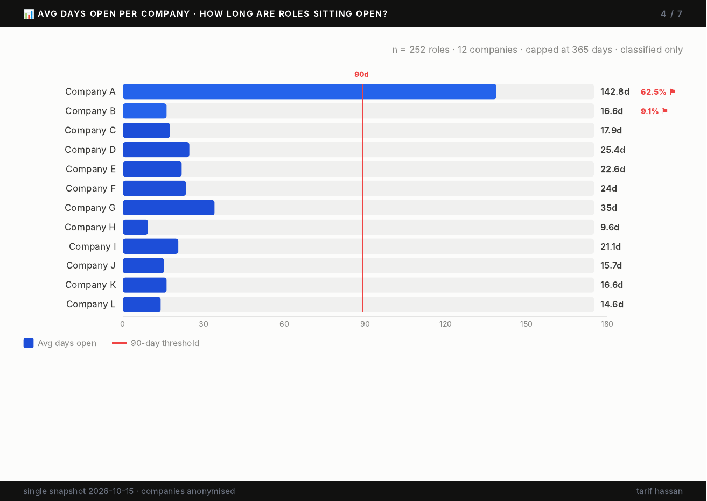
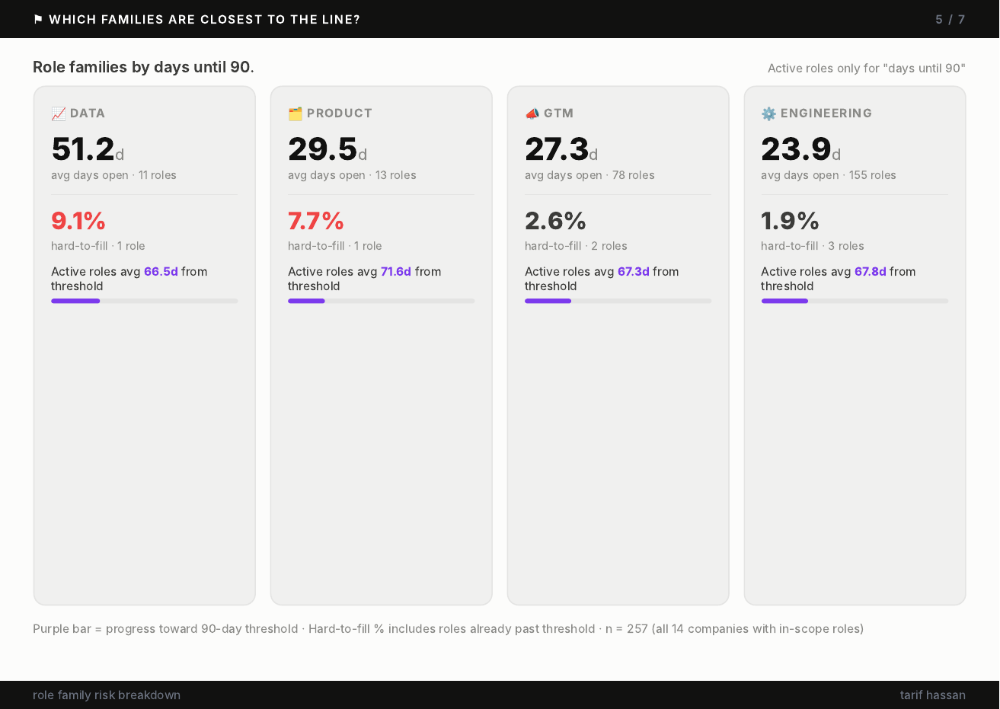
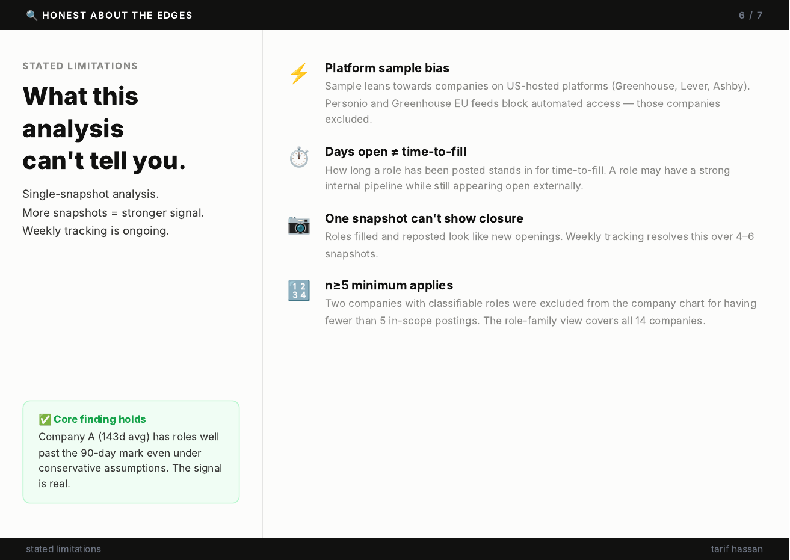
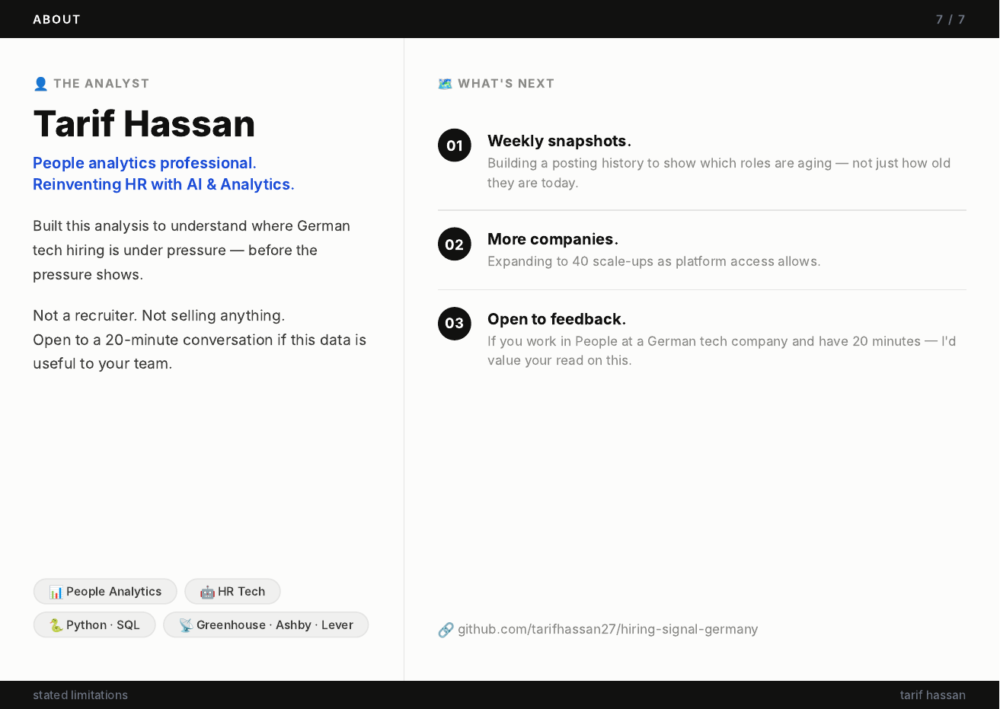

# Hiring Signal · Germany

**Which engineering, product, data and GTM roles in German tech are approaching the 90-day hard-to-fill threshold — and how much runway is left before they cross it?**

A data analysis of live job postings across 19 German tech scale-ups. Built from public ATS feeds. Single snapshot: 2026-10-15.

---

## The Problem

Most hiring teams don't track role age. By the time a role feels hard to fill, it's already past the threshold. The signal came weeks earlier.

The 90-day threshold is calibrated against this cohort: the p90 posting age across all 252 in-scope roles is 51 days. A role at 90 days is already past the 90th percentile of the distribution — a meaningful outlier, not an arbitrary cutoff.



---

## Why It Matters

A role that ages past 90 days doesn't just stay open — it creates downstream pressure. Candidates disengage. JD rewrites begin. Hiring managers lose confidence. Agencies get called at 150+ days at a premium, after the signal was already there.



---

## Methodology

Pulled directly from public ATS job feeds (Greenhouse, Ashby, Lever) — no scraping, no manual data entry. Every role classified by family using keyword matching on job title. Every posting dated, capped at 365 days to exclude stale outliers.

**Pipeline:**

```
Public ATS feeds (JSON)
  → raw.job_postings        597 rows
  → clean.job_postings      495 rows within 365-day cap · days_open · days_until_90 · role_family
  → In-scope roles          257 classified (non-NULL role_family) across 14 companies
  → n≥5 filter              252 roles across 12 companies (min. 5 in-scope roles per company)
  → 90-day threshold flag   status = hard_to_fill when days_open ≥ 90
  → Company + family summaries
```



---

## Company Benchmark

Average days open per company, in-scope roles only (n≥5 per company). 12 of 19 companies met the minimum threshold for inclusion. Two companies have at least one role past the 90-day mark.

The chart uses anonymised labels (Company A–L) to keep the public output clean. A private version with named companies is not committed to this repository.



---

## Role Family Signal

Which role families are closest to the hard-to-fill line? Data and GTM show the highest hard-to-fill rates. All four families have active roles averaging within striking distance of the 90-day threshold.

Note: the company benchmark (n=252) and role-family view (n=257) differ slightly — the family view includes all 14 companies with in-scope roles, while the company benchmark applies the n≥5 filter, dropping two companies. Both counts are intentional and correct for their respective views.



---

## Limitations

This is a single-snapshot analysis. The core findings hold, but there are edges worth stating:

- **Platform sample bias** — Sample leans towards companies on US-hosted ATS platforms. Personio and Greenhouse EU feeds block automated access.
- **Days open ≠ time-to-fill** — A role may have a strong internal pipeline while appearing open externally.
- **One snapshot can't show closure** — Roles filled and reposted look like new openings. Weekly tracking will resolve this over 4–6 snapshots.
- **n≥5 scope** — Two companies with classifiable roles were excluded for having fewer than 5 in-scope postings; their data is not surfaced in the company chart.



---

## About

Built by Tarif Hassan — people analytics professional, reinventing HR with AI & Analytics.

Not selling anything. Open to a 20-minute conversation if this data is useful to your team.



---

## Deck

Full presentation: [`05_outputs/deck/hiring_signal_germany.pdf`](05_outputs/deck/hiring_signal_germany.pdf)

---

## Data Note

Company names are anonymised in all committed outputs (Company A–L). Raw ATS feed snapshots, the company list, and named company data are not committed to this repository.

---

## How to Run

**Requirements:** Python 3.10+, PostgreSQL

```bash
pip install -r requirements.txt
playwright install chromium
```

Set DB credentials as environment variables before running:

```bash
export DB_HOST=localhost
export DB_PORT=5432
export DB_NAME=hiring_signal
export DB_USER=postgres
export DB_PASSWORD=your_password
```

**Check ATS feeds and collect a snapshot:**

```bash
python 02_data/feed_check.py
```

**Load snapshot into Postgres:**

```bash
python 02_data/load_raw.py
```

**Apply cleaning rules and classify roles (run in DBeaver or psql):**

```sql
\i 03_sql/clean_load.sql
```

**Run analysis and export CSVs:**

```bash
python 04_analysis/analyse.py
```

**View charts:**

Open `05_outputs/charts.html` in any browser.

---

## Stack

| Layer | Tool |
|---|---|
| ATS feeds | Greenhouse API · Ashby API · Lever API |
| Storage | PostgreSQL (`raw` + `clean` schemas) |
| Pipeline | Python · SQLAlchemy |
| Analysis | Python · pandas |
| Charts | HTML · JavaScript (inline) · Playwright (PNG render) |

---

*Snapshot date: 2026-10-15 · n = 252 in-scope roles (n≥5 per company) · 19 companies tracked · 12 in chart*
